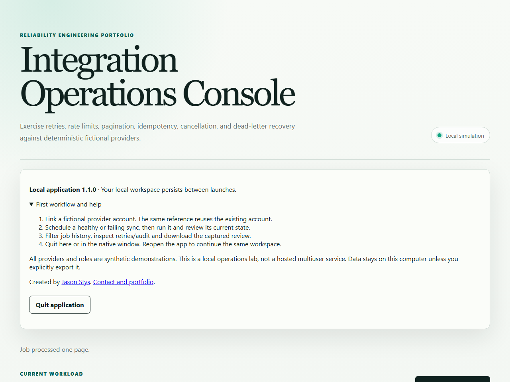
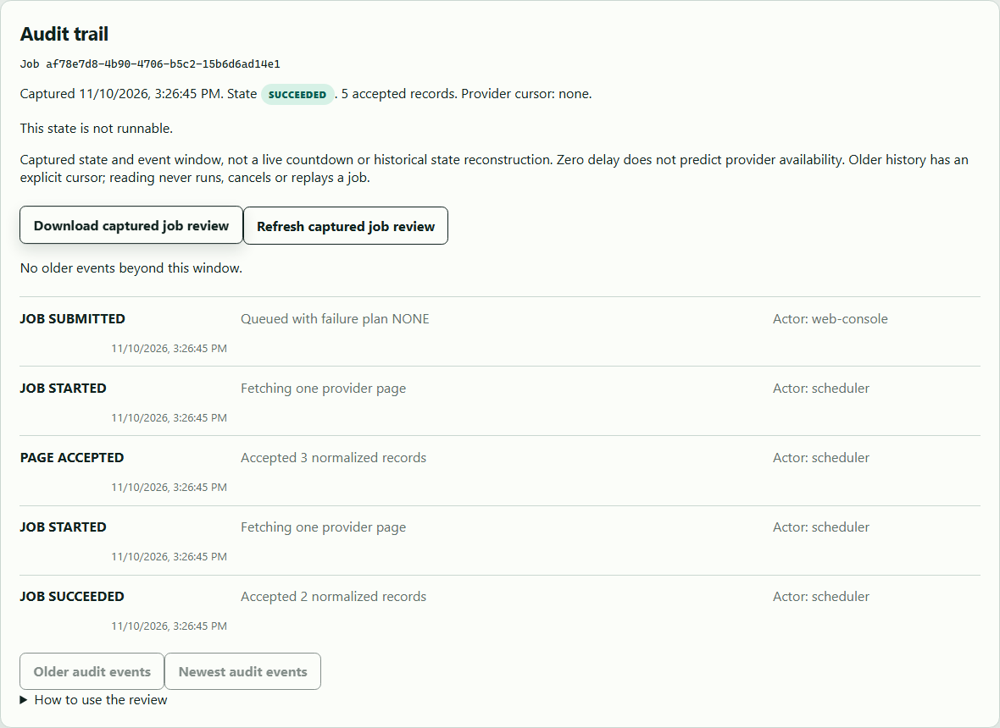
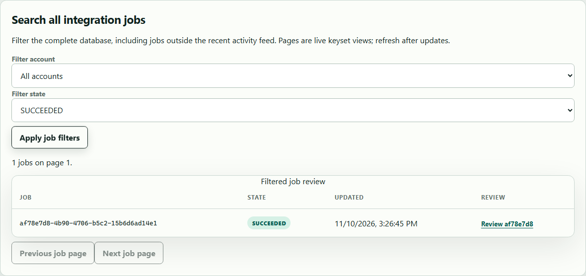

# Native application validation — 2026-11-10

The version 1.1.0 development app-image was built with Java 21 `jlink`/`jpackage`
from base `7789dd296b75f5a711f872c752dfc686ec15e2de` plus the explicitly dirty native
feature working tree. Embedded metadata and the [sanitized native receipt](native-application-2026-11-10.json)
retain that distinction; this is not a claim that a release at that base commit
already contains the new feature. No source was pushed, workflow dispatched,
release published or normal user workspace opened during this local acceptance.

| Observed gate                             | Result                                                                                                                                  |
| ----------------------------------------- | --------------------------------------------------------------------------------------------------------------------------------------- |
| Clean Maven verify on Java 21             | 45 tests, zero failures/errors/skips; zero Checkstyle violations                                                                        |
| Clean JaCoCo line gate                    | 675/847 lines, 79.69%; unchanged 70% minimum                                                                                            |
| Frontend verify                           | 34 tests, 199/209 lines (95.21%), lint/type generation/build passed                                                                     |
| Original actual Java/H2 browser workflows | All 14 desktop/mobile Chromium cases passed; zero retries                                                                               |
| Browser fixture guard tests               | Invalid/overlapping/occupied ports refused; existing listener preserved                                                                 |
| Genuine Windows app-image                 | Bundled runtime and compiled UI, launched from unrelated working directory with Java/Node absent from child PATH                        |
| Real packaged workflows                   | Healthy idempotent two-page sync accepted five records; permanent schema failure dead-lettered, replayed then explicitly cancelled      |
| Native visibility/readiness               | Actual Swing window reported showing in both launches; readiness follows successful native window construction                          |
| Durable restart                           | Private settings bytes unchanged; same linked account, completed/cancelled jobs and exact audit events retained                         |
| Local boundary/refusals                   | Missing/old session, cross-origin request and simulated viewer mutation refused; invalid input rejected; second workspace owner refused |
| Export/lifecycle                          | Actual captured JSON download inspected; actual EXE exited zero after each browser quit                                                 |
| Browser resource check                    | No renderer errors or third-party requests observed in either native browser context                                                    |

Normalized provider records are counted, not stored as a raw-data sink. The
retained database evidence concerns account/job/state/audit records and their
processed-record count. Tests use fictional business references and independent
expected counts, not personal/provider credentials.

## Defects found and corrected

Enabling the real status window exposed Spring's default headless mode: the
listener could start before window construction failed. The launcher now sets
the non-headless mode explicitly and publishes readiness only after the required
window starts. Final actual EXE acceptance leaves the window enabled and checks
its visibility in nonce/source-bound health at both starts.

The initial Windows test run also exposed dynamic test-agent attachment denial.
Mockito now loads at test JVM startup while retaining JaCoCo, and clean Maven
verification passes without dynamic attachment.

## Screenshots and interpretation

The following are real compiled browser UI captures from the disposable packaged
application, not mockups. The console overview is a viewport capture; the other
two intentionally capture their complete respective panels.

Computer Use independently listed the expected native window owned by the built
EXE. Its screenshot/input step returned **“Computer Use app approval timed out”**;
no native-button click or visual native-window capture is claimed. No alternate
OS input tool was used. The runtime visibility proof, browser screenshots, quit
acknowledgement tests and actual process-exit checks are separate evidence.

This is unsigned Windows app-image acceptance, not an OS installer test, a
clean-machine claim, a populated real-user upgrade or cross-OS native proof.
The newly authored read-only native workflow remains pending hosted acceptance.
Docker, installed applications, desktop shortcuts, normal profiles and published
releases were not changed. The older Word guide retains its own cited baseline;
new documentation editions can be generated from these current Markdown inputs.

## Patched-runtime and acceptance review

The follow-up Windows candidate uses the independently verified Temurin
21.0.13+9-LTS SDK, with process-local build settings only. Clean Maven `verify`
passed again, including all existing coverage and Checkstyle gates. The app image
records its SDK's actual runtime version in `SOURCE.json`; native acceptance
retains that value and hosted acceptance requires the exact clean checkout SHA.

The actual packaged browser journey was repeated without injecting a session
header into all browser requests. Only explicit API permission probes carry a
test-supplied header. Normal page requests must obtain their session through the
real client bootstrap, so a broken browser client cannot pass because of test
instrumentation. Five records, job/audit exports, role/Origin/session refusals,
settings and account/job/audit persistence and both real process exits passed.
There were zero third-party requests and both native windows reported visible.

One initial patched-runtime attempt could not find Chromium in the real user's
default Playwright cache. It stopped and preserved the failed receipt. Repeating
with the already-installed matching project browser cache passed; no product
code or browser expectation was relaxed. This remains a dirty development
candidate based on the source revision stated above; clean hosted acceptance and
independent released-package installation remain delivery gates.
